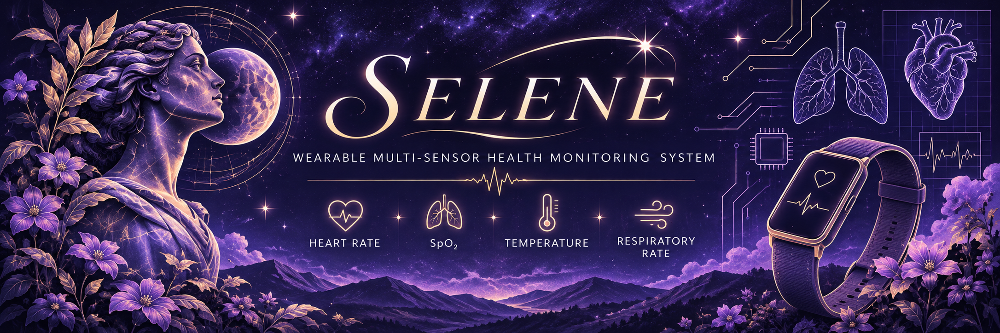
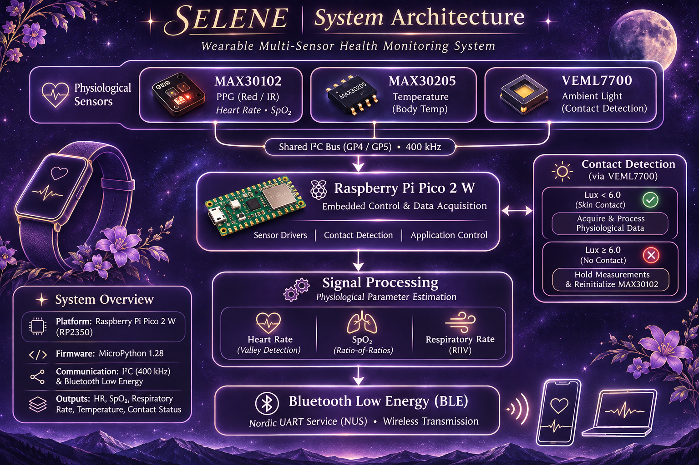

  

 

🌙 SELENE —
 Wearable Multi-Sensor Health Monitoring System

  <i>Continuous physiological monitoring through embedded systems, sensor integration, and wireless communication.</i>

---

## ✦ Project Overview

SELENE is a wearable multi-sensor health monitoring prototype developed to explore continuous acquisition of physiological measurements and improve awareness of sensor-to-skin contact.

Built around a **Raspberry Pi Pico 2 W**, the system integrates multiple sensors to acquire physiological data, processes the collected signals, and transmits measurements wirelessly through Bluetooth Low Energy (BLE).

The project emphasizes reliable sensor integration, signal quality, real-time contact detection, and modular embedded firmware.

**Project type:** Biomedical Engineering / Embedded Systems  
**Development platform:** Raspberry Pi Pico 2 W (RP2350)  
**Firmware:** MicroPython 1.28  
**Project collaborators:** Regina Velazquez and Sarah Garza

## ✧ System Architecture

The following diagram illustrates SELENE's sensor integration,
embedded processing, contact-detection logic, and wireless
communication architecture.

  

## ✧ System Features
- Multi-sensor physiological data acquisition
- Heart rate estimation from photoplethysmography (PPG) signals
- SpO₂ estimation using the ratio-of-ratios method
- Respiratory rate estimation using respiratory-induced intensity variation (RIIV)
- Temperature measurement
- Sensor-to-skin contact detection using ambient light sensing
- Bluetooth Low Energy data transmission
- Fault-tolerant firmware execution and sensor reinitialization

## ☾ Hardware Architecture

| Component | Function |
|---|---|
| Raspberry Pi Pico 2 W | Main microcontroller and wireless communication |
| MAX30102 | Optical PPG sensing for heart rate and SpO₂ estimation |
| MAX30205 | Digital temperature sensing |
| VEML7700 | Ambient light sensing for contact detection |
| Li-ion battery | Portable power source |
| Battery Management System | Battery charging and protection |

The three sensors communicate with the microcontroller through a shared I²C bus.

**I²C configuration:**
- SDA: GP4
- SCL: GP5
- Bus frequency: 400 kHz

## ✦ Firmware Architecture

The firmware was developed in MicroPython and organized into modular components to separate sensor communication, signal processing, wireless communication, and application-level functionality.

| Module | Responsibility |
|---|---|
| `main.py` | System initialization and main application loop |
| `max30102.py` | PPG sensor configuration and FIFO data acquisition |
| `max30205.py` | Temperature sensor driver |
| `veml7700.py` | Ambient light sensor driver and contact detection |
| `spo2_hr.py` | Heart rate, SpO₂, and respiratory rate calculations |
| `ble_simple_peripheral.py` | BLE peripheral communication |
| `ble_advertising.py` | BLE advertising payload generation |

### Signal Processing

**Heart Rate**

Calculated through valley detection on the infrared PPG waveform. Inter-beat intervals are converted into beats per minute (BPM).

**Blood Oxygen Saturation (SpO₂)**

Estimated using the ratio-of-ratios method, comparing the AC and DC components of the red and infrared PPG signals.

**Respiratory Rate**

Estimated using respiratory-induced intensity variation (RIIV). The infrared PPG signal is downsampled to isolate its lower-frequency respiratory component before detecting breath cycles.

**Temperature**

Measured through the MAX30205 digital temperature sensor. An empirically determined calibration offset was incorporated into the sensor driver for the breakout board used during development.

### Contact Detection

The VEML7700 ambient light sensor is used to identify whether the wearable is positioned against the skin.

A threshold of **6.0 lux** distinguishes covered and uncovered sensor conditions based on experimental testing.

When contact is lost, physiological measurements are withheld. When contact is re-established, the MAX30102 is reinitialized to clear stale FIFO data before a new sampling cycle begins.

## 📡 Wireless Communication

SELENE uses Bluetooth Low Energy through the Nordic UART Service (NUS) profile.

The device advertises as `Wearable` and transmits formatted measurement strings at approximately 2 Hz when connected.

Example data format:

`HR:x,SPO2:y,TEMP:z,RR:w,CONTACT:0/1`

This allows a compatible BLE client to receive the measurements wirelessly.

## ✧ Prototype & Enclosure

The enclosure was designed in SolidWorks with consideration for sensor alignment, electronics accessibility, and wearable attachment.

Design features included:

- Removable snap-top lid
- Dedicated sensor opening
- Sensor-to-skin contact positioning
- Wrist or arm band attachment points
- OLED display cutout for potential future integration

The OLED display was not incorporated into the final prototype due to parts availability.

## ☄️ Testing & Results

The final prototype demonstrated integration of all three I²C sensors on a shared 400 kHz bus.

Testing documented in the project report included:

- Sensor detection and I²C communication
- PPG data acquisition through the MAX30102 FIFO
- Ambient-light-based contact detection
- Temperature measurement and calibration
- Heart rate, SpO₂, and respiratory rate estimation
- BLE transmission of physiological measurements
- Recovery from transient errors and sensor reconnection

The prototype successfully demonstrated battery-powered wearable operation and wireless transmission of the measured parameters.

## ⚙️ Engineering Challenges

Several implementation challenges were encountered during development:

- **Temperature calibration:** The MAX30205 breakout board exhibited a systematic measurement offset, requiring empirical calibration.
- **BLE initialization:** The BLE stack needed to be initialized before activating the I²C peripheral on the Pico 2 W.
- **Sensor data management:** MAX30102 FIFO handling and reinitialization were important for obtaining fresh PPG samples after contact was restored.
- **Power stability:** Battery voltage instability during BLE transmission indicated the need for improved power decoupling in a future revision.

Documenting and resolving these issues was an important part of developing the integrated system.

## 🌱 Limitations & Future Development

SELENE is an engineering prototype and has not been clinically validated.

Future improvements identified during development include:

- Validation against medical-grade reference devices
- Improved motion-artifact rejection
- Multi-user temperature calibration
- Integration of the OLED display
- Improved battery power stability
- PCB redesign and hardware miniaturization
- Further refinement of the wearable enclosure

## 👩‍💻 Project Contributions

**Regina Velazquez — Embedded Software Lead**

- Developed the MicroPython firmware architecture.
- Implemented individual drivers for the MAX30205, VEML7700, and MAX30102.
- Developed the heart rate, SpO₂, and respiratory rate processing algorithms.
- Integrated the sensors through a shared I²C bus.
- Implemented BLE communication and data transmission.
- Developed the main application loop and fault-tolerant error recovery.
- Debugged sensor calibration, BLE initialization, and FIFO management issues.

**Sarah Garza — Hardware Lead**

- Led hardware integration and electrical assembly.
- Soldered the sensors, battery management system, and microcontroller.
- Designed the enclosure in SolidWorks.
- Developed the wearable enclosure and sensor placement.
- Verified electrical connections and supported hardware testing.

## ✨ Acknowledgments

Developed as a collaborative engineering project at **Virginia Commonwealth University**.

*SELENE is part of the StarlightStitcher Engineering Archive.*

---

*Curiosity is universal. Engineering makes it tangible.* 🌙
